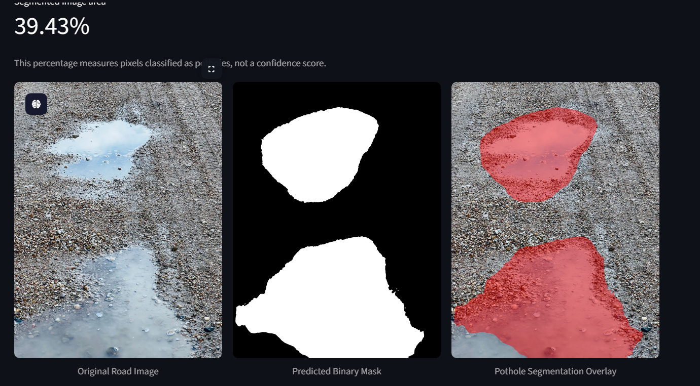
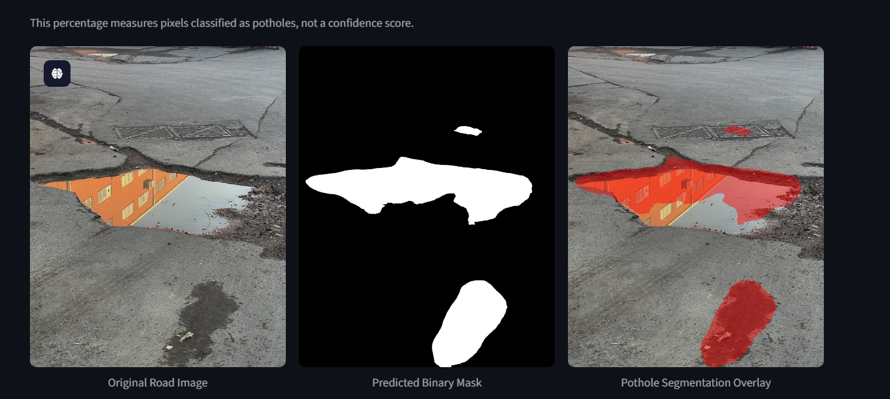

# RoadGuard AI — Pothole Segmentation

**Road pothole segmentation using PyTorch, U-Net with a ResNet encoder, and Streamlit.**

RoadGuard AI predicts a **pixel-level binary mask** for potholes in road images. The project includes a Streamlit image-upload app and an OpenCV script for live webcam or video-file inference. The predicted regions are highlighted in red.

> **Project status:** Demonstration / computer-vision portfolio project. Segmentation results are predictions, not a certified road-safety assessment.

## Features

- **Streamlit image app:** Upload JPG, JPEG, PNG, or WEBP images.
- **Three views:** Original image, binary segmentation mask, and red overlay.
- **Interactive controls:** Segmentation threshold and overlay opacity.
- **Download:** Save the overlaid image as a PNG.
- **Webcam and video:** Process a camera stream (`--source 0`) or a video file, optionally saving the processed video.
- **Checkpoint loading:** Load a trained PyTorch checkpoint and infer the ResNet encoder type from its state-dict keys (supported by the included scripts).
- **GPU support:** Uses CUDA when available; otherwise CPU.

## Example predictions

The app presents three side-by-side outputs:

| Original road image | Predicted binary mask | Pothole overlay |
|---|---|---|
| Input image | White = predicted pothole pixels | Red = predicted pothole regions |

The **“Segmented image area”** percentage is the proportion of image pixels classified as potholes. **It is not model confidence or a measure of physical pothole area.**

## Project structure

```text
RoadGuard-AI/
├── app.py                         # Streamlit image inference
├── webcam.py                      # Webcam and video inference
├── models/
│   └── best.pth                   # Trained checkpoint (supply your own)
├── videos/                        # Optional input videos
├── pothole-segmentation-unet.ipynb # Training and evaluation notebook
├── requirements.txt
└── README.md
```

The trained checkpoint is **not included** with this README. Put your checkpoint at `models/best.pth` or specify an alternate path as described below.

## Installation

Use a supported Python environment and install the dependencies:

```bash
python -m venv .venv
```

Activate it on Windows:

```powershell
.venv\Scripts\activate
```

Or on macOS/Linux:

```bash
source .venv/bin/activate
```

Then install:

```bash
pip install -r requirements.txt
```

> **PyTorch GPU installation:** For a particular NVIDIA CUDA setup, use the installation command recommended at [pytorch.org/get-started/locally](https://pytorch.org/get-started/locally/). The requirements file does not pin a CUDA build.

## Run the Streamlit image app

```bash
streamlit run app.py
```

1. Upload a road image.
2. Adjust the **Mask threshold** (default `0.50`) and **Overlay opacity**.
3. Review the original image, binary mask, and red overlay.
4. Click **Download Segmented Image** to save the overlay.

By default the app loads `models/best.pth`. To use another checkpoint, set the `ROADGUARD_WEIGHTS` environment variable before launching:

```powershell
# Windows PowerShell
$env:ROADGUARD_WEIGHTS = "models/my_model.pth"
streamlit run app.py
```

```bash
# macOS/Linux
ROADGUARD_WEIGHTS=models/my_model.pth streamlit run app.py
```

## Run webcam or video inference

**Webcam:**

```bash
python webcam.py --source 0
```

**Video file:**

```bash
python webcam.py --source videos/video1.mp4
```

**Resize the processed/display frames:**

```bash
python webcam.py --source 0 --width 1280 --height 720
```

**Adjust segmentation threshold:**

```bash
python webcam.py --source videos/video1.mp4 --threshold 0.6
```

**Save processed video:**

```bash
python webcam.py --source videos/video1.mp4 --save outputs/result.mp4
```

**Alternate model path:**

```bash
python webcam.py --source 0 --weights models/my_model.pth
```

Press **Q** or **Esc** to close the OpenCV window. Webcam/video processing speed depends on hardware, video resolution, and the selected encoder.

## Model and preprocessing

| Setting | Implementation |
|---|---|
| Task | Binary semantic segmentation |
| Architecture | U-Net with ResNet encoder via `segmentation_models_pytorch` |
| Input | RGB image resized to `256 × 256` |
| Normalization | ImageNet mean `[0.485, 0.456, 0.406]`, std `[0.229, 0.224, 0.225]` |
| Output | One-channel logits → sigmoid probabilities → thresholded mask |
| Overlay | Red mask blended with the source image |

The uploaded training notebook contains a **ResNet101** model definition, while the included inference scripts inspect the checkpoint to determine its actual encoder. **The architecture in the checkpoint must match the instantiated model**; changing the encoder name alone does not convert a trained model. The checkpoint may be a plain `state_dict` or a dictionary containing `model_state_dict`.

If your checkpoint was trained with **only `/255` normalization**, you must change inference preprocessing to match. Incorrect normalization can reduce segmentation quality. 

## Example predictions

### Prediction 1


### Prediction 2


## Training notebook

`pothole-segmentation-unet.ipynb` covers data loading, conversion of YOLO polygon labels into binary masks, augmentation, model training, and evaluation. Its training configuration includes:

- Albumentations for image/mask-aligned augmentations.
- BCE + Dice loss.
- Dice score and IoU evaluation.
- AdamW optimization, learning-rate scheduling, and early stopping.
- Best-checkpoint saving and prediction visualizations.

The training data comes from the [Pothole Image Segmentation Dataset on Kaggle](https://www.kaggle.com/datasets/farzadnekouei/pothole-image-segmentation-dataset). Consult the dataset page for its license and usage terms.

## Limitations

- Performance may vary with shadows, puddles, lighting, camera angles, and road textures.
- Water, stains, or other dark regions may be incorrectly segmented as potholes.
- Image segmentation is not pothole depth estimation, severity grading, or geographic reporting.
- The Streamlit app accepts **images only**; use `webcam.py` for webcam/video inference.
- No verified benchmark metrics are claimed here; evaluate the exact deployed checkpoint on a held-out test set before reporting performance.

## Tech stack

Python · PyTorch · segmentation-models-pytorch · OpenCV · Streamlit · NumPy · Pillow · Albumentations (training notebook)
